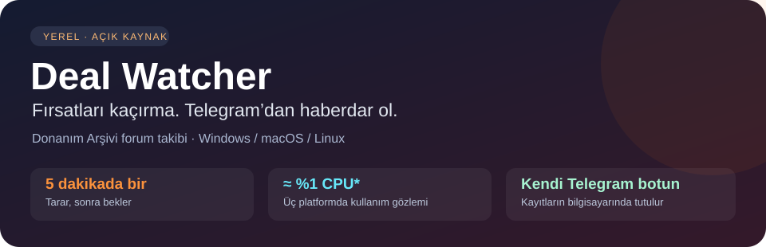

<div align="center">



[](https://github.com/Darkem0/deal-watcher/releases/tag/v0.3.0-alpha)
[](https://github.com/Darkem0/deal-watcher/actions/workflows/ci.yml)
[](docs/telegram-kurulum.md)
[](LICENSE)

**Forumda fırsat aramak yerine, yeni fırsatlar Telegram'ına gelsin.**

Donanım Arşivi Sıcak Fırsatlar'ı bilgisayarında takip eden hafif uygulama.Windows · macOS · Linux — kendi botun, yerel kayıtlar, yaklaşık beş dakikada bir tarama.

[İndir](#-sistemini-seç-indir-ve-aç) · [Telegram'ı bağla](docs/telegram-kurulum.md) · [İzin / hata yardımı](#-bir-şey-çalışmadı-mı) · [English](docs/README.en.md)

</div>

## 🚀 Sistemini seç, indir ve aç

**Git veya Python'u elle kurman gerekmiyor.** Aşağıdaki ZIP'i indir, tamamen çıkart ve içindeki başlatıcıyı aç. İlk açılışta gerekli `uv` kurulumuna onay verirsin; Python ve bağımlılıkları yardımcı hazırlar. İlk kurulum için internet gerekir.

> [!TIP]
> **GitHub'da dosyaya tıklamak programı çalıştırmaz.** ZIP'i indirip çıkartmalısın; başlatıcıyı ZIP'in içinden veya tek dosya olarak açma. Diğer dosyalar da aynı klasörde bulunmalı.

<table>
<tr>
<td align="center"><a href="https://github.com/Darkem0/deal-watcher/releases/download/v0.3.0-alpha/deal-watcher-windows-v0.3.0-alpha.zip"></a></td>
<td align="center"><a href="https://github.com/Darkem0/deal-watcher/releases/download/v0.3.0-alpha/deal-watcher-macos-v0.3.0-alpha.zip"></a></td>
<td align="center"><a href="https://github.com/Darkem0/deal-watcher/releases/download/v0.3.0-alpha/deal-watcher-linux-v0.3.0-alpha.zip"></a></td>
</tr>
<tr><td align="center"><b>Baslat-Windows.cmd</b></td><td align="center"><b>Baslat-macOS.command</b></td><td align="center"><b>Baslat-Linux.sh</b></td></tr>
<tr><td align="center">Sağ tık ZIP → Tümünü ayıkla<br/>Başlatıcıya çift tıkla</td><td align="center">ZIP'e çift tıkla<br/>Başlatıcıyı aç</td><td align="center">ZIP'i çıkart<br/>Program olarak çalıştır*</td></tr>
<tr><td align="center"><a href="docs/izinler-windows.md">Windows izin / hata rehberi</a></td><td align="center"><a href="docs/izinler-macos.md">macOS izin / hata rehberi</a></td><td align="center"><a href="docs/izinler-linux.md">Linux izin / hata rehberi</a></td></tr>
</table>

Üç paket aynı uygulamayı içerir; ana klasörde yalnız sistemine uygun başlatıcı bulunur. Paket adları: `deal-watcher-windows-v0.3.0-alpha.zip`, `deal-watcher-macos-v0.3.0-alpha.zip`, `deal-watcher-linux-v0.3.0-alpha.zip`.

\* Linux'ta dosya yöneticisi scripti metin olarak açabilir; bu durumda klasörde terminal açıp `bash Baslat-Linux.sh` yaz. macOS dosya izinleri engellerse `bash Baslat-macOS.command` kullan veya yukarıdaki izin rehberini izle. Windows'ta ZIP'i çıkartıp `.cmd` dosyasını aç; yönetici olarak çalıştırmak normal kurulum için gerekmez.

<details>
<summary><b>🪟 Windows: terminalden indirip başlat</b></summary>

PowerShell'i açıp aşağıdaki bloğu yapıştır. Yeni klasör `Downloads\DealWatcher-v0.3.0-alpha` altında oluşturulur:

```powershell
$dw_zip = "$env:USERPROFILE\Downloads\deal-watcher-windows-v0.3.0-alpha.zip"
$dw_folder = "$env:USERPROFILE\Downloads\DealWatcher-v0.3.0-alpha"
Invoke-WebRequest "https://github.com/Darkem0/deal-watcher/releases/download/v0.3.0-alpha/deal-watcher-windows-v0.3.0-alpha.zip" -OutFile $dw_zip
Expand-Archive -LiteralPath $dw_zip -DestinationPath $dw_folder
& "$dw_folder\deal-watcher\Baslat-Windows.cmd"
```

Klasör zaten varsa ikinci kopya kurmak yerine mevcut başlatıcıyı aç. [Windows yardımı](docs/izinler-windows.md).

</details>

<details>
<summary><b>🍎 macOS: terminalden indirip başlat</b></summary>

Terminal'de:

```sh
mkdir -p "$HOME/Downloads/DealWatcher-v0.3.0-alpha"
cd "$HOME/Downloads/DealWatcher-v0.3.0-alpha"
curl -fL "https://github.com/Darkem0/deal-watcher/releases/download/v0.3.0-alpha/deal-watcher-macos-v0.3.0-alpha.zip" -o deal-watcher-macos-v0.3.0-alpha.zip
unzip deal-watcher-macos-v0.3.0-alpha.zip
cd deal-watcher
bash Baslat-macOS.command
```

Apple Silicon ve Intel'de Python'u `uv` uygun mimariyle kurar. [macOS yardımı](docs/izinler-macos.md).

</details>

<details>
<summary><b>🐧 Linux: terminalden indirip başlat</b></summary>

Terminal'de:

```sh
mkdir -p "$HOME/Downloads/DealWatcher-v0.3.0-alpha"
cd "$HOME/Downloads/DealWatcher-v0.3.0-alpha"
curl -fL "https://github.com/Darkem0/deal-watcher/releases/download/v0.3.0-alpha/deal-watcher-linux-v0.3.0-alpha.zip" -o deal-watcher-linux-v0.3.0-alpha.zip
unzip deal-watcher-linux-v0.3.0-alpha.zip
cd deal-watcher
bash Baslat-Linux.sh
```

`curl` veya `unzip` bulunamazsa [Linux rehberindeki dağıtım adımlarına](docs/izinler-linux.md) bak. Bu başlatma için systemd gerekmez.

</details>

## 💬 Telegram'ını bağla — telefondan başlayabilirsin

1. Telefonda Telegram'dan **[resmî BotFather'ı aç](https://t.me/BotFather)** ve `/newbot` yaz.
2. Botuna ad ve `bot` ile biten kullanıcı adı ver. BotFather bir token verecek.
3. Bilgisayardaki başlatıcıya token'ı yapıştır. **Girişte yazı görünmemesi normaldir.**
4. Chat ID sorulduğunda **Enter** bas; telefonda kendi botunu açıp **`/start`** gönder.
5. Bilgisayarda tekrar **Enter** bas. Yardımcı sohbeti bulur, ayarı kaydeder ve takibi başlatır.

### ➜ [Telefondan bot oluşturma, token kopyalama ve grup bağlantısını resimli akışla öğren](docs/telegram-kurulum.md)

İlk kurulumu bir kez yaparsın. Sonraki açılışlarda aynı `Baslat-…` dosyası doğrudan takibi başlatır. Bilgisayarın açık ve çevrimiçi olmalı; bu pencereden başlattıysan pencereyi açık tut. Durdurmak için **Ctrl+C**. Pencere istemiyorsan [otomatik başlatmayı kur](docs/kurulum.md#otomatik-başlatma).

> [!NOTE]
> Botun `/start` mesajına sohbet cevabı vermemesi normaldir; bu bir bildirim botudur. İlk forum taraması mevcut konuları kaydeder, eski fırsatları topluca göndermez. Başlangıç ve ilk başarılı tarama durum mesajı gelebilir; yeni fırsatlar sonraki taramalarda gelir.

## 🔥 Ne işe yarıyor?


| Özellik | Sana faydası |
| --- | --- |
| Türkçe ürün sınıflandırması | Ekran kartı, işlemci, depolama ve diğer kategorileri ayırır |
| Stok / kupon sinyalleri | Acil fırsatları önceliklendirir |
| Aksesuarları ayıran kurallar | Örneğin ekran kartı standını ekran kartı sanmayı azaltır |
| Kalıcı SQLite kayıtları | Yeniden başlatınca görülen konular ve başarılı teslimler korunur |
| Olay ve teslim tekilleştirmesi | Aynı olayın başarılı kanal teslimini tekrar etmez |
| Sessiz ilk tarama | Kurulumda eski konuların mesaj yağmuru olmaz |

**Bugüne kadar:** forum parserı, Türkçe sınıflandırma, kalıcı kayıtlar, Telegram bildirimleri, kontrollü ağ erişimi ve üç işletim sistemi için çalışma akışı geliştirildi. Bu sürümde indir–aç başlatıcıları, yönlendirmeli Telegram kurulumu ve platforma özel yardım sayfaları eklendi. [Diğer projelerden farkları](docs/proje-farklari.tr.md).

## 🌿 Günlük kullanımda hafif

**Üç platformdaki kullanım gözlemim:** Windows, macOS ve Linux'ta CPU tüketimi yaklaşık **%1 civarında**; beş dakikalık taramalar arasında işlemci işi çok az, bellek kullanımı genellikle dengeli. Tarama anında kısa süreli artış olabilir. Bu bir kullanım gözlemidir, her bilgisayar için garanti edilen sınır değildir.

| Beklerken | Tarama sırasında | Donanım |
| --- | --- | --- |
| Scheduler uyuyarak bekler; CPU çok düşük | Sayfayı okuyup kayıtları işler; kısa süreli CPU artışı | GPU / AI modeli / Qdrant gerekmez |

Linux'taki kısa **offline testte** tepe RAM **44 MiB** ölçüldü. Bu Windows/macOS ölçümü veya uzun dönem canlı kullanım ortalaması değildir. Normal çalışma bağımlılıkları yaklaşık 32 MiB'dı; Python ve indirme önbelleği ayrıca yer kaplar. [Ölçüm yöntemi ve disk/ağ ayrıntıları](docs/kurulum.md#ne-kadar-kaynak-tüketir).

## 🧭 Bir şey çalışmadı mı?

| Durum | Rehber |
| --- | --- |
| Windows engeli, PowerShell, açılıp kapanan pencere | [🪟 Windows izinleri ve çözümleri](docs/izinler-windows.md) |
| macOS geliştirici / çalıştırma izni / Terminal sorunu | [🍎 macOS izinleri ve çözümleri](docs/izinler-macos.md) |
| Linux'ta metin olarak açılma, curl/unzip, systemd | [🐧 Linux izinleri ve çözümleri](docs/izinler-linux.md) |
| Token, Chat ID, mesaj gelmemesi veya grup bağlantısı | [💬 Telegram rehberi](docs/telegram-kurulum.md) |
| Arka planda çalıştırma, güncelleme, kaldırma | [⚙️ Ayrıntılı kurulum ve kullanım](docs/kurulum.md) |

<details>
<summary><b>Bilinen sınırlar, gizlilik ve geliştirici belgeleri</b></summary>

- Forumun şu an yalnız ilk liste sayfası izlenir; varsayılan aralık beş dakika + 10–45 saniye jitter'dır.
- `digest` öncelik etiketidir; toplu gönderim kuyruğu değildir.
- Akakçe deneysel ve varsayılan kapalıdır; CAPTCHA aşma veya otomatik satın alma yoktur.
- Her kullanıcı kendi botunu kullanır. Aynı token ile ayrı veritabanları çift bildirim oluşturabilir.
- `.env`, SQLite ve loglar kişiseldir; paylaşma. Bildirim metinleri Telegram'a gönderilir, kayıtlar yerelde tutulur.
- Ön sürüm: forum HTML'i değişince güncelleme gerekebilir. CI offline testleri doğrular; gerçek teslim ve servis açılışı yerel kontrol ister.

[Geliştirici başlangıcı](docs/development/README.md) · [Mimari](docs/architecture.md) · [Katkı](.github/CONTRIBUTING.md) · [Güvenlik](.github/SECURITY.md) · [Referanslar](docs/acknowledgements.md) · [MIT lisansı](LICENSE)

</details>
