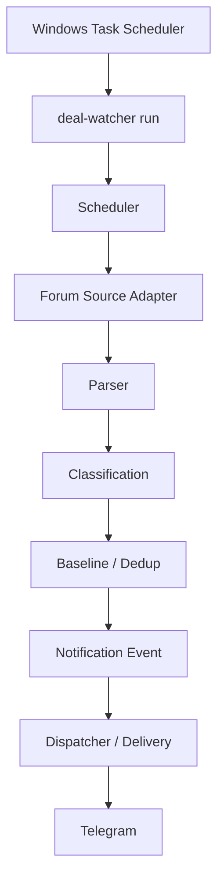
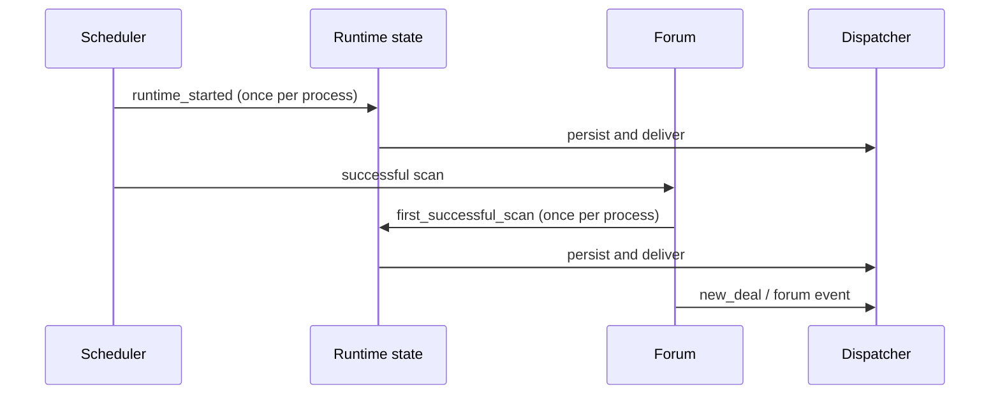

# Architecture

Deal Watcher keeps source adapters, parsing, domain decisions, storage, and notification delivery separate. The core is platform-independent; Windows Task Scheduler is a deployment adapter.

## Lifecycle flow

## Modules

- `sources/`: controlled HTTP source adapters and fixture parsers.
- `services/`: forum processing, classification, price history, and notification conversion.
- `storage/`: SQLite schema, migrations, repositories, event and delivery records.
- `notifiers/`: channel adapters and the shared dispatcher.
- `runtime.py`: UTF-8 console setup, timezone conversion, shutdown, instance lock, and process-local lifecycle state.
- `scheduler.py`: jittered jobs, failure backoff, and one-start callback.
- `cli.py`: configuration loading and command orchestration.

The first successful Forum scan establishes baseline state. Event persistence happens before dispatch; delivery status is tracked per event and channel. Lifecycle state is deliberately not persisted as a daily heartbeat.

## Source boundary

Donanım Arşivi is the active Forum source. Akakçe parser code and fixtures are retained for offline/experimental work, but live Akakçe is disabled by default because controlled direct HTTP verification returned 403. No access-control bypass is implemented.
